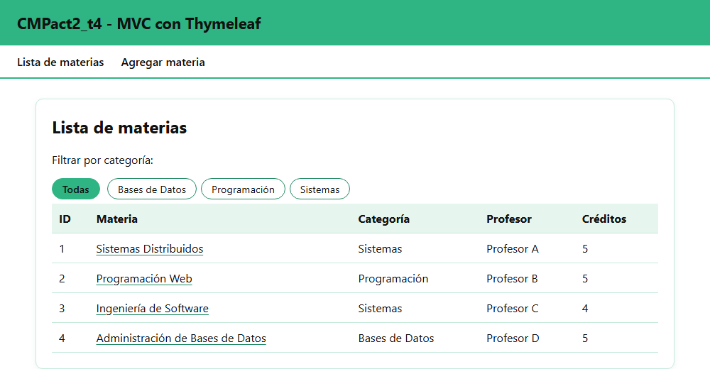
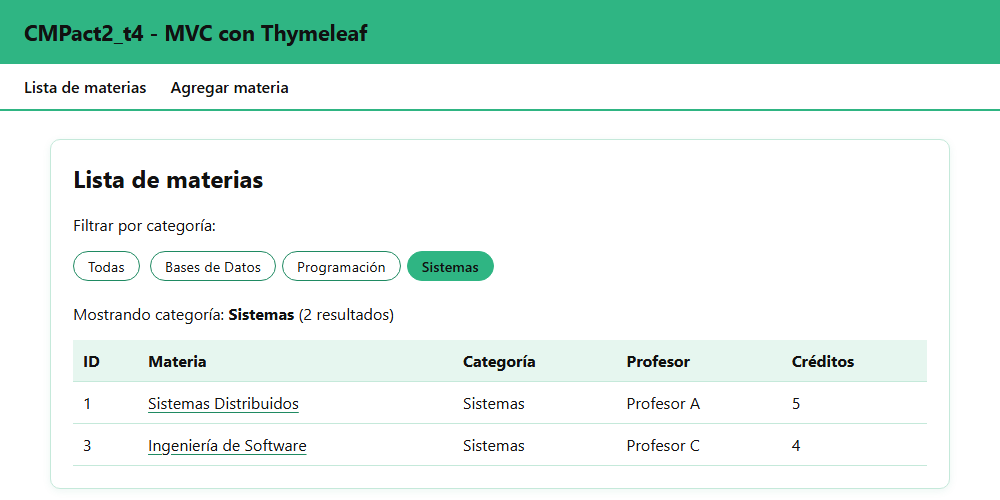
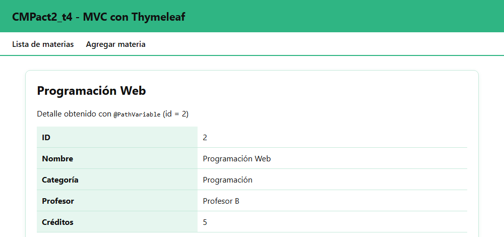
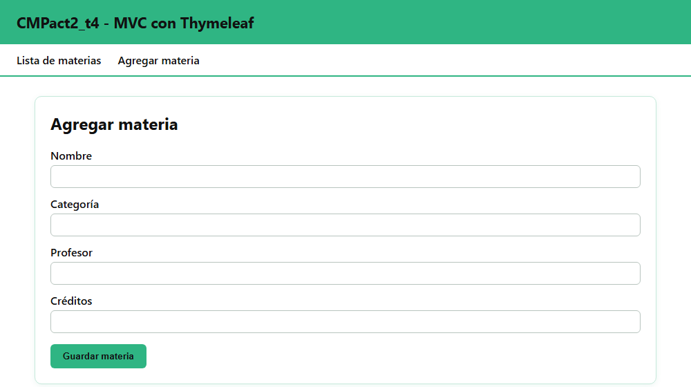
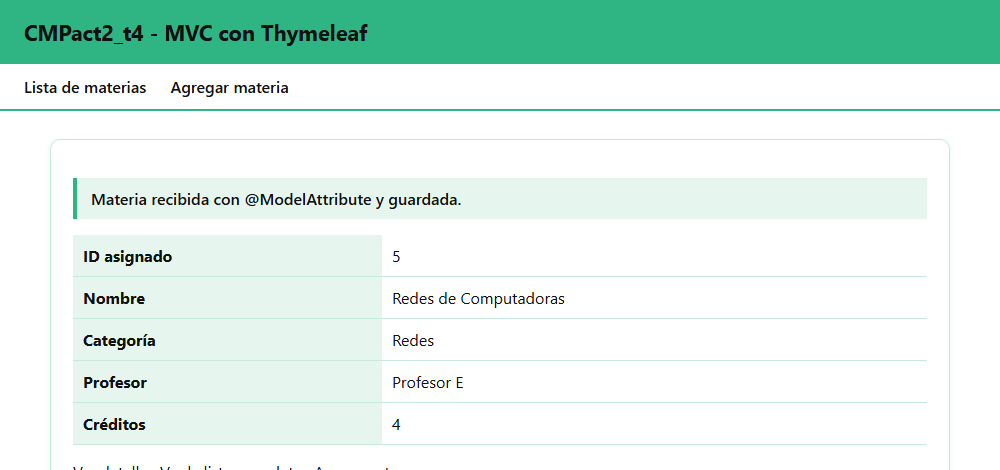
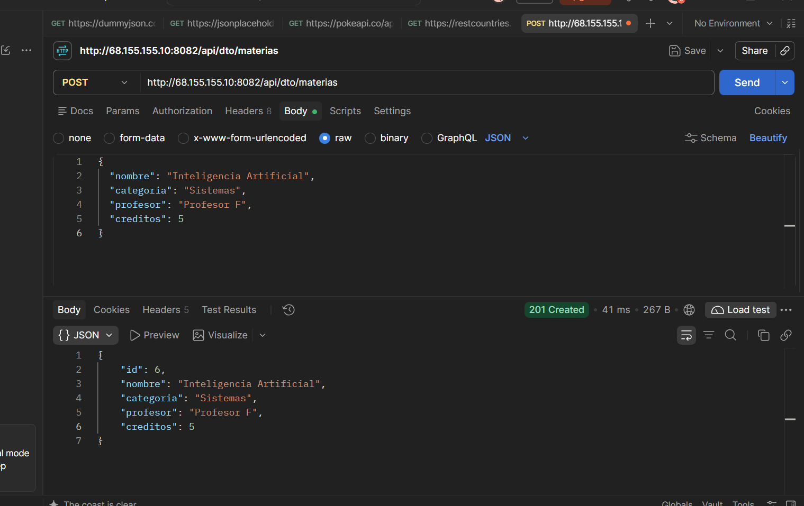

# CMPact2_t4

Actividad 2, Tema 4: patrón MVC en Spring Boot con Thymeleaf, clases DTO, `@RequestParam`, `@PathVariable`, `@ModelAttribute`, `@Value` y peticiones POST con Postman.

Es una copia independiente del proyecto de la Actividad 1 ([CMPact1_t4](https://github.com/CristianMartinezz1/CMPact1_t4)), que sigue sin cambios.

**Alumno:** Cristian Martínez Pacheco · Matrícula 23161016 · Grupo 7SC

## Requisitos
- JDK 21 o superior
- No es necesario instalar Maven: el proyecto incluye Maven Wrapper (`mvnw` / `mvnw.cmd`)

## Ejecutar en local
```bash
./mvnw spring-boot:run        # Linux / Mac / Git Bash
mvnw.cmd spring-boot:run      # Windows CMD / PowerShell
```
El servidor levanta en el puerto **8082** (la Actividad 1 usa el 8081). Abre http://localhost:8082/materias

## Estructura MVC

| Capa | Archivos |
|---|---|
| **Modelo** | `dto/MateriaDTO.java` (datos) y `service/MateriaService.java` (lista simulada en memoria) |
| **Vista** | `templates/materias/lista.html`, `detalle.html`, `formulario.html`, `resultado.html` y `fragments.html` (Thymeleaf) |
| **Controlador** | `controller/MateriaViewController.java` (`@Controller`, regresa vistas) y `controller/MateriaRestController.java` (`@RestController`, regresa JSON) |

## Endpoints

| Tipo | Método | Ruta | Qué demuestra |
|---|---|---|---|
| Vista | GET | `/materias` | Lista con `Model` + `th:each` |
| Vista | GET | `/materias?categoria=Sistemas` | Filtro con `@RequestParam` |
| Vista | GET | `/materias/{id}` | Detalle con `@PathVariable` |
| Vista | GET | `/materias/nueva` | Formulario enlazado al DTO (`th:object` / `th:field`) |
| Vista | POST | `/materias/nueva` | Recibe el formulario con `@ModelAttribute` |
| REST | GET | `/api/dto/materias` | Lista en JSON |
| REST | POST | `/api/dto/materias` | Recibe un `MateriaDTO` en JSON con `@RequestBody` |
| REST | GET | `/api/proyecto`, `/api/materias`, `/status` | Endpoints heredados de la Actividad 1 |

`@Value` lee la propiedad personalizada `app.nombre-proyecto` de `application.properties`, y se muestra como título en el encabezado de todas las vistas.

## Capturas de pantalla

### 1. Lista de materias con `th:each`
`GET /materias`: el controlador pone la lista en el `Model` y la vista la recorre con `th:each`. El título del encabezado es el valor leído con `@Value`.



### 2. Filtro con `@RequestParam`
`GET /materias?categoria=Sistemas`



### 3. Detalle con `@PathVariable`
`GET /materias/2`



### 4. Formulario con `@ModelAttribute`
`GET /materias/nueva`: el formulario está enlazado al `MateriaDTO` con `th:object` y `th:field`.



Al enviarlo (`POST /materias/nueva`), el controlador recibe el DTO lleno con `@ModelAttribute` y muestra el resultado:



### 5. Petición POST en Postman
`POST /api/dto/materias` con este cuerpo JSON (`Content-Type: application/json`):
```json
{
  "nombre": "Inteligencia Artificial",
  "categoria": "Sistemas",
  "profesor": "Profesor F",
  "creditos": 5
}
```
Respuesta `201 Created` con el DTO guardado y su `id` asignado:



## Compilar y desplegar
```bash
./mvnw clean package
java -jar target/cmpact2_t4-0.0.1-SNAPSHOT.jar --server.port=8082
```

## Proyecto en el VPS
- http://68.155.155.10:8082/materias
- https://cristian-mp.mexicocentral.cloudapp.azure.com/act2-t4/materias

La Actividad 1 sigue corriendo en su puerto original: http://68.155.155.10:8081/api/proyecto
